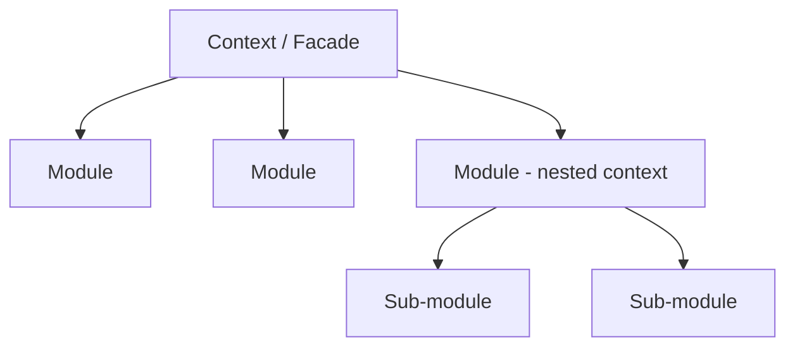
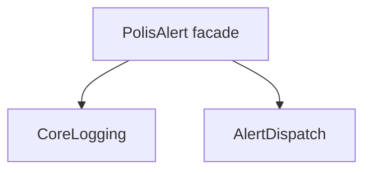

# SynthKernel

SynthKernel is a TypeScript module composition architecture built on a single function: `createContext`. It takes an ordered array of module classes, instantiates each with a shared context object, merges the keys they contribute, and injects the result back. Modules are plain classes receiving a single context constructor parameter.

The package ships `createContext`, two type utilities (`MergeSingleKey` and `Context`), and three reactive primitives (`ref`, `computed`, `hook`). You build everything else (event systems, registries, schedulers, plugin management) as modules on top of the same primitive.

## The problem

When you build a modular TypeScript application, you typically reach for a dependency injection framework. DI frameworks bring containers, decorators, lifecycle managers, and sometimes their own plugin ecosystems. They solve real problems, but they also impose their own architecture on yours.

SynthKernel starts from a different premise. One function composes plain classes into a shared, type-safe context. The context is an API pool where modules put their public methods in, and read what they need from siblings. The class that calls `createContext` becomes a facade, exposing those methods to consumer code.

## The model

A SynthKernel application is a tree of contexts. Each context is created by `createContext` and holds a flat set of module APIs. Modules are the leaves; a context is the branch that groups them.



Three roles:

- A module is a plain class. It receives context in its constructor and contributes public APIs through a `root` property.
- A context is the object `createContext` returns. The class that creates it acts as a facade for consumer code.
- A nested context is a module that creates its own `createContext` internally, grouping related modules and plumbing parent APIs down as `preMerge`.

A context with five modules does not need a sub-context. A context with thirty might. The tree grows when a module's responsibilities expand beyond what one class should hold.

Information flows bidirectionally through this tree. Raw infrastructure and module instantiation order flow down. Module APIs and type declarations flow up. A module accesses siblings through the injected context. A parent feeds a child context through `preMerge`. Every dependency is visible in constructor signatures and `preMerge` calls.

## How composition works

`createContext(classes, options)` returns a context object. The `classes` array is ordered: each module is instantiated in sequence, receiving the context built so far. The `options` control what gets merged and injected back.

```typescript
createContext([ModuleA, ModuleB], {
  mergeKeys: ['options', 'root'], // keys pulled from each instance into context
  injectKeys: ['options', 'root'], // keys written back to instances (defaults to mergeKeys)
  preMerge: { baseUrl: '...' }, // values available before any module constructs
  postMerge: { version: 3 }, // values merged after all modules, before injection
});
```

The merge runs in four phases:

1. `preMerge` values are merged into the empty context. These are available to every module's constructor.
2. Each module is instantiated with the context so far, and its `mergeKeys` are pulled out and merged in. The `root` key is special: its contents flatten into the context root, so `context.someMethod` works instead of `context.root.someMethod`.
3. `postMerge` values are merged on top.
4. `injectKeys` are written back to every instance. A module that declares `options` receives the fully merged options object, not just its own slice.

The returned context also carries three non-enumerable helpers: `__getModule__(ctor)` returns a module instance by constructor, `__assign__(obj)` merges values into the context after creation, and `__addModule__(ctor)` dynamically adds a module at runtime.

## Modules

A module is a plain class. The constructor takes whatever the module needs from the context, typed structurally:

```typescript
class MyModule {
  declare options: { myOption: string }; // type-only: context injects runtime value
  constructor(private readonly ctx: { neededApi: () => void }) {}
  root = { myMethod: this.myMethod }; // flattens into context root
}
```

`declare` marks a type-only contribution. The property has no runtime value; `createContext` injects the merged result via `injectKeys`. The module reads the full combined type at runtime with full type safety.

Structural constructor typing means the module declares only the keys it uses. This decouples modules from each other and from the full context shape. In tests, you pass a plain object with mock implementations and the module cannot tell the difference.

`root` is the module's public API. Its contents flatten into the context root level, so `context.myMethod()` works instead of `context.root.myMethod()`.

## Type orchestration

When each module declares its own `options` slice, the facade needs to combine them into one type. SynthKernel ships two utilities for this.

`MergeSingleKey<Modules, 'options'>` takes the module array type and a key name, and produces the merged type of that key across all modules. If `CoreLogging` declares `options: { logLevel: Level }` and `AlertDispatch` declares `options: { minMessageLength: number }`, the result is `{ logLevel: Level; minMessageLength: number }`.

`Context<Modules, 'options' | 'root'>` produces the full context type after merging all specified keys from all modules, including the flattened `root`. The facade uses this to type its private context reference and to expose root APIs on itself.

Both are re-exported from the facade so consumer code and external packages use the same orchestrated types.

## Scaling

When a module list grows too long, group related modules into a nested context. A module creates its own `createContext` internally and plumbs parent APIs down through `preMerge`:

```typescript
class NetworkModule {
  private subCtx;

  constructor(ctx: { log: (msg: string) => void; baseUrl: string }) {
    this.subCtx = createContext([HttpModule, WsModule], {
      mergeKeys: ['root'],
      preMerge: { log: ctx.log, baseUrl: ctx.baseUrl },
    });
    for (const ctor of [HttpModule, WsModule]) this.subCtx.__getModule__(ctor).onStart();
  }

  root = { ...this.subCtx };

  onDispose() {
    for (const ctor of [HttpModule, WsModule].reverse())
      this.subCtx.__getModule__(ctor).onDispose();
  }
}
```

Sub-context modules see only the plumbed parent APIs and their own siblings. The parent context sees whatever the nested module exposes through `root`.

A second scaling tool is interception. Because modules are instantiated in order and share the same context object, a module later in the array can wrap an earlier module's API in its constructor. This is how middleware works in SynthKernel: logging, caching, and auth wrapping are all modules placed after the module they wrap.

## Example: PolisAlert

PolisAlert is a logging and alerting service built from two modules:

- `CoreLogging` provides configurable, leveled logging with an audit trail.
- `AlertDispatch` validates alert messages and dispatches them to an external service.



`CoreLogging` exposes `log` and `logs` through `root`. `AlertDispatch` needs `log` from its sibling, so it declares it in its constructor. The facade merges both modules' `options` into one type-safe configuration object.

```typescript
import type { MergeSingleKey, Context as ConstructContext, Hook } from 'synthkernel';
import { createContext, hook } from 'synthkernel';
console.log('SynthKernel imported');
```

### CoreLogging

CoreLogging contributes two options (`logLevel` and `maxLogs`), exposes `log`, `logs`, and `onLogOverflow` through `root`, and logs to the console based on the configured level. The `onLogOverflow` hook fires when the log buffer exceeds `maxLogs` and the oldest entry is dropped.

```typescript
const LEVELS = { DEBUG: 0, INFO: 1, WARN: 2, ERROR: 3 } as const;
type Level = keyof typeof LEVELS;

interface LogEntry {
  timestamp: number;
  level: Level;
  message: string;
}

interface BaseOptions {
  appName: string;
  debug?: boolean;
}

class CoreLogging {
  private logs: LogEntry[] = [];
  private readonly onOverflow = hook<[LogEntry]>();

  declare options: { logLevel: Level; maxLogs?: number } & BaseOptions;

  private readonly log = (level: Level, message: string) => {
    const currentLevel = LEVELS[level];
    const minLevel = LEVELS[this.options.logLevel] ?? 0;
    if (currentLevel < minLevel) return;
    const entry: LogEntry = { timestamp: Date.now(), level, message };
    const maxLogs = this.options.maxLogs ?? 1000;
    if (this.logs.length >= maxLogs) this.onOverflow(this.logs.shift()!);
    this.logs.push(entry);
    console.log(`[${level}] ${message}`);
  };

  onStart() {
    this.log('INFO', 'CoreLogging initialized');
  }
  onDispose() {
    this.log('INFO', 'CoreLogging disposed');
    this.logs = [];
  }

  root = {
    log: this.log,
    logs: this.logs,
    onLogOverflow: this.onOverflow,
  };
}
console.log('CoreLogging defined');
```

### AlertDispatch

AlertDispatch needs `log` from CoreLogging and `onLogOverflow` to react when logs are dropped. It declares both in its constructor, structurally typed. It does not import `CoreLogging` or know about the full context.

```typescript
class AlertDispatch {
  private readonly unsub: () => void;

  declare options: {
    minMessageLength: number;
    maxMessageLength: number;
  };

  constructor(
    private readonly ctx: {
      log: (level: Level, msg: string) => void;
      onLogOverflow: Hook<[LogEntry]>;
    },
  ) {
    this.unsub = ctx.onLogOverflow.subscribe((log) =>
      this.dispatchAlert(`Log overflow: ${JSON.stringify(log)}`),
    );
  }

  dispatchAlert = async (message: string): Promise<boolean> => {
    this.ctx.log('INFO', `Attempted dispatch: "${message}"`);
    const { minMessageLength, maxMessageLength } = this.options;
    if (message.length < minMessageLength) {
      this.ctx.log('ERROR', `Validation failed: message too short (min: ${minMessageLength})`);
      return false;
    }
    if (message.length > maxMessageLength) {
      this.ctx.log('ERROR', `Validation failed: message too long (max: ${maxMessageLength})`);
      return false;
    }
    await this.connectAlertService(message);
    return true;
  };

  private readonly connectAlertService = async (alert: string) => {
    this.ctx.log('INFO', `Dispatched: "${alert}"`);
    await new Promise((resolve) => setTimeout(resolve, 10));
  };

  onStart() {
    this.ctx.log('INFO', 'AlertDispatch initialized');
  }
  onDispose() {
    this.unsub();
    this.ctx.log('INFO', 'AlertDispatch disposed');
  }

  root = { dispatchAlert: this.dispatchAlert };
}
console.log('AlertDispatch defined');
```

### Facade

The facade declares the module array, derives the combined options type and the full context type, creates the context, assigns runtime options, starts the modules, and exposes root APIs on itself.

```typescript
const allModules = [CoreLogging, AlertDispatch] as const;
type AllModules = typeof allModules;

type Context = ConstructContext<AllModules, 'options' | 'root'>;
type AllOptions = MergeSingleKey<AllModules, 'options'>;

class PolisAlert {
  private ctx?: Context;

  dispatchAlert: Context['dispatchAlert'];
  log: Context['log'];
  logs: Context['logs'];

  constructor(public options: AllOptions) {
    this.ctx = createContext(allModules, {
      mergeKeys: ['options', 'root'],
    }).__assign__({ options });

    for (const ctor of allModules) this.ctx.__getModule__(ctor).onStart();

    // Root API exposure
    this.dispatchAlert = this.ctx.dispatchAlert;
    this.log = this.ctx.log;
    this.logs = this.ctx.logs;
  }

  dispose = () => {
    for (const ctor of allModules.toReversed()) this.ctx?.__getModule__(ctor).onDispose();
    this.ctx = undefined;
  };
}
console.log('PolisAlert facade defined');
```

### Running it

The consumer creates a `PolisAlert` with type-safe options from both modules, calls `log` and `dispatchAlert` directly on the facade, and disposes when done.

```typescript
const app = new PolisAlert({
  appName: 'PolisAlert',
  debug: true,
  logLevel: 'DEBUG',
  maxLogs: 500,
  minMessageLength: 1,
  maxMessageLength: 280,
});

app.log('INFO', 'Application started');

const success = await app.dispatchAlert('Hello Polis');
console.log('Dispatch result:', success);

console.log('Audit trail:', app.logs);

app.dispose();
```

## When to use SynthKernel

SynthKernel fits single-state applications: CLI tools, compilers, rich desktop clients, plugin frameworks, build systems. These share a long-lived context where modules collaborate through stable APIs.

Multi-request servers work too. The context is an API pool, not mutable runtime state. Request-scoped data comes from factories exposed through `root`. Concurrent requests share stable APIs without racing.

For small projects (under a few hundred lines), a single file is simpler. SynthKernel's composition overhead benefits when you have enough modules that wiring them by hand becomes error-prone.

## Closing

The example composes two modules into a facade with full type safety, lifecycle management, and inter-module communication. The facade exposes three methods. Each module declares only what it needs. The options type is derived from the modules, not written by hand.

SynthKernel's contribution is the composition mechanism: `createContext`, the merge flow, and the type utilities. Everything else in the example is application code in plain classes. You write the modules. SynthKernel composes them.
